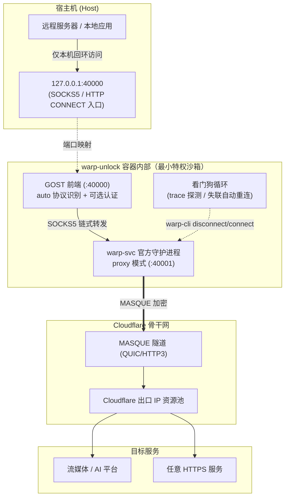

# WARP Unlock Docker v2.0（官方客户端 MASQUE 版）

[](https://www.debian.org/)
[](https://pkg.cloudflareclient.com/)
[](#)
[](#)
[](#)
[](#)

专为 VPS / 云服务器打造的容器化 Cloudflare WARP 代理网关。

基于 **Debian + Cloudflare 官方 warp-svc 客户端（MASQUE 协议）+ GOST** 构建：不创建 TUN 设备、不改路由表，仅需 `NET_ADMIN` capability（无需 `privileged`），通过官方 proxy 模式对外提供 **SOCKS5 / HTTP CONNECT 双协议**代理，内置看门狗自动重连与 WARP+ License 绑定。

---

## 🌟 核心特性

* 🏛️ **Cloudflare 官方客户端（warp-svc + MASQUE）**：
  使用官方 APT 源安装的 `cloudflare-warp`，协议演进由 Cloudflare 官方跟进（proxy 模式仅支持 MASQUE），无需自行维护 WireGuard 配置生成逻辑。
* 🛡️ **最小特权**：
  无需 `/dev/net/tun` 设备、无需 `privileged`，仅需 `NET_ADMIN` capability（新版 warp-svc 连接建立后会安装 fwmark 策略路由规则，此为官方客户端硬性要求），不创建虚拟网卡——常规 Docker 环境开箱即跑。
* 🔀 **同端口双协议**：
  GOST 前端 `auto` 协议自动识别，`40000` 端口同时接受 `socks5h://`、`socks5://` 与 `http://` 客户端。
* 🔒 **可选代理认证**：
  配置 `PROXY_USER` / `PROXY_PASS` 即启用 HTTP Basic + SOCKS5 user/pass 认证，公网暴露也无需担心被扫描白嫖；默认仅绑定 `127.0.0.1`。
* ➕ **WARP+ License 一键升级**：
  `WARP_LICENSE` 环境变量自动执行 `warp-cli registration license`，绑定结果实时反映在启动日志与诊断报告中。
* 🐕 **隧道看门狗**：
  定期（默认 60 秒，可调）探测 `warp=on/plus`，隧道失联自动 disconnect/connect 重连，长期无人值守稳定在线。
* 📺 **流媒体解锁巡检 + 自动刷 IP**：
  内置 `unlock-check.sh` 定期检测 Netflix / Disney+ / ChatGPT（`UNLOCK_STREAMS`），未通过自动重连轮换出口 IP（单轮最多 3 次），检测历史写入 `./logs/unlock.log`。
* 🌍 **出口地区验证 + 自定义入口**：
  `WARP_REGION` 设定期望出口地区（校验 trace `loc=`，不匹配触发轮换）；高级用户可用 `WARP_ENDPOINT` 钉住特定 Cloudflare 入口 IP 影响落地 colo。
* 🐳 **预构建镜像 + 每日自动重建**：
  GitHub Actions 自动构建 AMD64/ARM64 双架构镜像并推送 Docker Hub 与 GHCR；每日定时重建，持续跟进基础镜像与官方客户端的安全更新。

---

## 🏗️ 架构拓扑图



---

## ⚠️ v1.x → v2.0 架构变更说明

本版本从 **WGCF + wireguard-go（WireGuard 协议）** 全面切换为 **官方客户端（MASQUE 协议）**：

| 项目 | v1.x (WGCF) | v2.0 (官方客户端 MASQUE) |
| :--- | :--- | :--- |
| 所需权限 | `/dev/net/tun` + `NET_ADMIN` | 仅 `NET_ADMIN`（无需 TUN 设备） |
| 协议 | WireGuard UDP | MASQUE（QUIC/HTTP3） |
| 代理协议 | SOCKS5（GOST） | SOCKS5 + **HTTP CONNECT**（同端口） |
| WARP+ License | `wgcf update --license-key` | `warp-cli registration license` |
| 出口地区定向 | ✅ WGCF 配置直接指定 | ⚠️ `WARP_REGION` 验证 + `WARP_ENDPOINT` 钉入口（高级） |
| 解锁检测/自动刷 IP | ✅ 每 5 分钟 | ✅ `UNLOCK_STREAMS` 巡检 + 失败轮换（可配间隔） |
| 出口 IP 轮换 | 重连隧道即换 IP | 重启容器 / `warp-cli disconnect && connect` |
| 适用环境 | 需 TUN 的常规 VPS | 常规 Docker 环境（无需 TUN，需 NET_ADMIN） |

> 如果依赖「WGCF 精确地区切换」能力，请继续使用 v1.x（`master` 分支）；
> 如果更看重官方维护与协议兼容性，v2.0 是更优解（解锁检测与刷 IP 已回归；权限上免去 TUN 设备，仅需 NET_ADMIN）。

---

## 📁 目录结构

```text
warp-unlock-docker/
├── Dockerfile                   # Debian + 官方 cloudflare-warp + GOST 构建（含瘦身清理）
├── docker-compose.yml           # 服务编排（cap_add: NET_ADMIN）
├── .env.example                 # 环境变量配置模板
├── .github/workflows/
│   └── docker-image.yml         # 预构建镜像 CI（多架构 + 每日重建）
├── config/                      # 挂载卷：warp-svc 注册状态持久化
├── logs/                        # 挂载卷：GOST 日志 + 解锁检测历史
│   ├── gost.log
│   └── unlock.log
├── scripts/
│   ├── entrypoint.sh            # 注册 → License → Endpoint → proxy 模式 → GOST → 巡检循环
│   ├── unlock-check.sh          # 流媒体解锁检测 + 出口地区验证
│   └── check-status.sh          # 容器一键状态诊断脚本
└── tools/
    └── warp-ping.sh             # 宿主机链路耗时与 IPv4/IPv6 握手分析工具
```

---

## 🚀 快速开始

### 方案 A：预构建镜像（推荐，开箱即用）

```bash
# Docker Hub
docker run -d --name warp-unlock \
  --restart unless-stopped \
  --cap-add NET_ADMIN \
  -p 127.0.0.1:40000:40000 \
  -v $(pwd)/config:/var/lib/cloudflare-warp \
  hausthy/warp-unlock:latest

# 或 GitHub Container Registry
docker run -d --name warp-unlock \
  --restart unless-stopped \
  --cap-add NET_ADMIN \
  -p 127.0.0.1:40000:40000 \
  -v $(pwd)/config:/var/lib/cloudflare-warp \
  ghcr.io/hausthy/warp-unlock:latest
```

> 镜像由 CI 每日自动重建（跟进官方客户端与基础镜像安全更新）；
> 如需暴露公网，请先配置认证并将端口改为 `-p 0.0.0.0:40000:40000`（强烈建议配合 `PROXY_USER/PROXY_PASS`）。

### 方案 B：本地构建 + docker compose

```bash
cp .env.example .env      # 按需修改（WARP_LICENSE、认证等）
docker compose up -d --build
docker compose logs -f warp-unlock
```

首次启动时容器会自动：
1. 拉起 `warp-svc` 并注册免费 WARP 账户（状态持久化在 `./config`，重启不重复注册）；
2. 如配置了 `WARP_LICENSE` 则绑定升级 WARP+；
3. 切换 proxy 模式并建立 MASQUE 隧道；
4. 启动 GOST 前端（`:40000`）与看门狗。

### 方案 C：从源码构建测试（服务器）

```bash
# 1. 克隆分支（HTTPS 免登录；国内服务器慢可加镜像前缀 https://ghfast.top/）
git clone -b feat/masque-official-client https://github.com/hausthy/warp_unlock.git warp-unlock-v2
cd warp-unlock-v2

# 2. 准备环境变量（按需填写 WARP_LICENSE / WARP_REGION / UNLOCK_STREAMS 等）
cp .env.example .env

# 3. 分层构建并启动（首次构建约 2-4 分钟，需可访问 pkg.cloudflareclient.com 与 GitHub）
docker compose up -d --build

# 4. 跟踪启动日志，看到 "WARP (MASQUE) 隧道已连通" 即成功
docker compose logs -f warp-unlock

# 5. 验证代理（SOCKS5 与 HTTP CONNECT 同端口）
curl -x socks5h://127.0.0.1:40000 https://www.cloudflare.com/cdn-cgi/trace | grep warp
curl -x http://127.0.0.1:40000 https://www.cloudflare.com/cdn-cgi/trace | grep warp

# 6. 一键诊断（含解锁检测实时结果与巡检历史）
docker compose exec warp-unlock /app/check-status.sh

# 7. 跟踪解锁巡检记录
tail -f logs/unlock.log

# 8. 查看镜像体积（验证分层瘦身效果）
docker images | grep warp-unlock
```

> 测试完成后清理：`docker compose down`；彻底重来（清账户）：`docker compose down && rm -rf config/*`

### 镜像体积与构建参数

最终镜像 **~139MB**（默认开启 UPX）/ **~190MB**（`UPX_WARP_SVC=0` 回退不压缩），从初版 330MB 优化而来。
瘦身手段：UPX 压缩三件套（gost/warp-cli/warp-svc）、静态 curl（SHA256 强校验）、
清除 apt/perl/gconv 冗余组件、scratch 压平镜像层。

| 构建参数 | 默认 | 说明 |
| :--- | :--- | :--- |
| `UPX_WARP_SVC` | `1` | UPX 压缩 warp-svc 守护进程（省 ~50MB）。若守护进程出现异常，改回 `0` 重建即回退 |
| `GOST_VERSION` | `2.11.5` | GOST 版本 |
| `CURL_STATIC_VERSION` | `8.23.0-1` | 静态 curl 版本（stunnel/static-curl，构建期 SHA256 强校验） |
| `UPX_VERSION` | `4.2.4` | UPX 版本 |
| `DEBIAN_RELEASE` | `bookworm` | 基础镜像发行版 |

```bash
# compose 方式：默认即开启 UPX，直接重建即可
docker compose up -d --build

# 或 docker build 直接指定（不加 --build-arg 亦默认开启）
docker build -t warp-unlock:test .

# 回退不压缩版本（守护进程异常时）
docker build --build-arg UPX_WARP_SVC=0 -t warp-unlock:test .

# 排障专用：构建带完整 shell 的未压平中间层镜像（scratch 终版无 apt/dpkg）
docker build --target runtime -t warp-unlock:debug .
```

> 说明：官方客户端 MASQUE 架构的体积硬成本 = debian-slim 基座（glibc）约 65MB +
> warp-svc 自带私有库 `/usr/lib/warp` 约 42MB，这两块无法再压缩；
> seiry/docker-warp-proxy 的 50MB 是 wgcf 静态单文件架构，不含上述组件。

---

## ⚙️ 环境变量详解 (`.env`)

| 变量名 | 默认值 | 说明 |
| :--- | :--- | :--- |
| `WARP_LICENSE` | 空 | 26 位 WARP+ License（`xxxxxxxx-xxxxxxxx-xxxxxxxx`），留空为免费账户 |
| `PROXY_USER` / `PROXY_PASS` | 空 | 代理认证（两者同时填写才生效），HTTP Basic + SOCKS5 user/pass |
| `UNLOCK_STREAMS` | `ndc` | 解锁检测项：`n` (Netflix)、`d` (Disney+)、`c` (ChatGPT)，留空则不检测 |
| `UNLOCK_INTERVAL` | `300` | 解锁巡检间隔（秒） |
| `WARP_AUTO_UNLOCK` | `1` | 是否开启解锁巡检 + 自动刷 IP（`0` 关闭，仅保留隧道看门狗） |
| `WARP_REGION` | 空 | 期望出口地区（两位代码），非空时巡检校验 `loc=` 是否匹配 |
| `WARP_ENDPOINT` | 空 | （高级）自定义入口 `IP:PORT`，钉住入口影响落地 colo |
| `WARP_WATCHDOG_INTERVAL` | `60` | 看门狗巡检间隔（秒），失联自动重连 |
| `GOST_VERSION` | `2.11.5` | GOST 构建版本 |

---

## 🧪 验证与测试

```bash
# SOCKS5 模式（远程 DNS 解析）
curl -x socks5h://127.0.0.1:40000 https://www.cloudflare.com/cdn-cgi/trace | grep warp
# 输出 warp=on（或 plus）即代理生效

# HTTP CONNECT 模式（同一端口）
curl -x http://127.0.0.1:40000 https://www.cloudflare.com/cdn-cgi/trace | grep warp

# 查询出口 IP
curl -x socks5h://127.0.0.1:40000 https://api.ip.sb/ip

# 确认端口仅监听本机回环
ss -lntp | grep 40000

# 一键完整诊断
docker compose exec warp-unlock /app/check-status.sh

# 宿主机链路分析
./tools/warp-ping.sh chatgpt.com
```

---

## 📺 联动 Sing-box / Xray 分流

与 v1.x 用法完全一致，将流媒体/AI 流量指向 `127.0.0.1:40000` 的 `socks` 出站即可（示例见 v1.x 文档或仓库历史）；HTTP 类客户端也可直接使用 `http://127.0.0.1:40000`。

---

## 🔍 FAQ

### Q1: 如何更换/轮换出口 IP？
```bash
# 容器内重连
docker compose exec warp-unlock warp-cli --accept-tos disconnect && \
docker compose exec warp-unlock warp-cli --accept-tos connect
# 或直接重启容器
docker compose restart warp-unlock
```

### Q2: 解锁地区定向和刷 IP 是怎么实现的？和 v1.x 有什么不同？
v2.0 通过**巡检 + 轮换**实现：
- `unlock-check.sh` 每 `UNLOCK_INTERVAL` 秒检测 Netflix/Disney+/ChatGPT 与出口地区（`WARP_REGION`）；
- 未通过则 `warp-cli disconnect && connect` 轮换出口 IP（单轮最多 3 次），通过即保持。

与 v1.x 的差异：MASQUE 模式下官方客户端不提供地区强制切换，`WARP_REGION` 是**验证目标**——轮换通常只能改变同区域内的出口 IP 与解锁状态，若你的 VPS 所在 colo 始终无法满足期望地区，可尝试 `WARP_ENDPOINT` 钉住其他地区的 Cloudflare 入口 IP（高级玩法，需自行寻找可用入口），或回退 v1.x（WGCF 可直接改配置选地区）。

### Q3: 如何使用 WARP+ License？
编辑 `.env` 填入 `WARP_LICENSE` 后 `docker compose up -d`，日志出现 `WARP+ License 绑定成功` 即升级完成；失败常见原因：License 无效、设备数已满（5 台）、网络不可达。

### Q4: 如何彻底重置账户？
```bash
docker compose down && rm -rf config/*
```

### Q5: 公网暴露安全吗？
默认端口仅绑定 `127.0.0.1`，外网不可达。如需公网使用：务必配置 `PROXY_USER/PROXY_PASS` 认证后再将端口映射改为 `0.0.0.0`。

### Q6: 日志报 `fwmark policy rule ... Operation not permitted` 后无限重连？
新版 warp-svc 在连接建立后会向容器网络命名空间安装 fwmark 策略路由规则（`ip rule`），缺少 `NET_ADMIN` capability 时会失败并触发断开重连循环。确认 `docker-compose.yml` 中包含：

```yaml
cap_add:
  - NET_ADMIN
```

修改后需要**重新创建容器**（`docker compose up -d --force-recreate`，仅 `restart` 不会重算能力集）。

---

## 📜 鸣谢与致敬

* [seiry/docker-warp-proxy](https://github.com/seiry/docker-warp-proxy)：官方客户端 proxy 模式容器化思路与 warp-cli 版本兼容处理的灵感来源
* [ginuerzh/gost](https://github.com/ginuerzh/gost)：功能强大的安全代理工具（前端双协议与认证）
* [Cloudflare WARP Client for Linux](https://pkg.cloudflareclient.com/)：官方客户端
